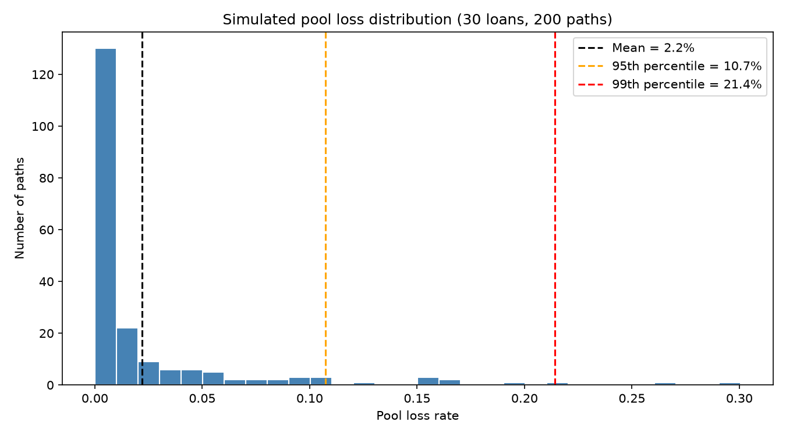

# CMBS Credit Risk & Monte Carlo Model

**High-level Summary:** A loan-level and pool-level credit risk model for commercial mortgage-backed securities, built in Python with an emphasis on model validation. The loan engine takes a CMBS loan from its amortization schedule through term and maturity default, refinancing and workout. The pool model places 30 such loans under a one-factor (Vasicek-style) correlated shock and simulates the pool loss distribution, then checks the simulated tail against the closed-form Vasicek quantile. The schedule, factor structure, closed-form quantile and end-to-end simulation chain are each checked against an independent calculation in automated tests.

## Project structure

| File | Purpose |
|---|---|
| `loan_model.py` | Loan engine: amortization schedule, credit metrics, stress test, refinance test, loss severity, scenario path, month-by-month scenario runner |
| `validation.py` | Independent validator for the amortization schedule: 17 checks against closed-form and `numpy-financial` benchmarks |
| `pool_model.py` | Pool engine: synthetic loan tape, one-factor shock generator, Monte Carlo pool simulation, closed-form Vasicek loss quantile |
| `test_loan_model.py` | 8 tests on the amortization schedule and its validator (positive, negative, edge-case) |
| `test_pool_model.py` | 12 tests on the pool engine (factor structure, Merton identity, Vasicek known answers, simulation consistency) |
| `main.py` | Demo script: single-loan examples, base-case pool run, sensitivity tables, Vasicek comparison, loss-distribution chart |
| `loss_distribution.png` | Histogram of simulated pool loss rates produced by `main.py` |

## Methodology

### Loan level

**Amortization schedule:** Standard annuity payment on a 30-year amortization, with an optional interest-only period at the start and a balloon at maturity. Supports full-term IO and zero-rate loans.

**Credit metrics:** DSCR, debt yield and LTV from NOI, annual debt service, loan balance and property value (value = NOI / cap rate).

**Default triggers:** A loan is in term default in the first month where both DSCR < 1.0 and LTV > 0.95. The double trigger reflects that a borrower with negative equity but covered debt service usually keeps paying, and one with positive equity but a DSCR shortfall usually sells or recapitalizes; 0.95 is 1 minus 5% selling costs. At maturity the loan faces a *refinance test*: the largest new loan a lender would make under minimum DSCR, maximum LTV and minimum debt yield constraints. If proceeds fall short and LTV > 0.95, then the loan is a *maturity default*; if proceeds fall short but the sponsor has equity, the outcome is *refinance shortfall, cured* (sponsor pays down). Otherwise it performs.

**Loss severity:** On default the property is liquidated at a discount to value, less liquidation costs. The lender's exposure is the balance at default plus accrued interest over the resolution period plus special-servicing fees. Severity is loss divided by balance at default.

**Scenario path:** Monthly NOI and cap-rate paths over the loan term: a base growth rate, an optional shock month after which NOI declines geometrically to a trough over a chosen number of months, and an optional shocked cap rate.

### Pool level

**Loan tape:** 30 synthetic loans with balances, coupons, IO periods, debt yields, cap rates and factor loadings drawn from fixed ranges under a seed, so the pool is reproducible.

**One-factor shock:** Each path draws one systematic shock M ~ N(0,1) shared by every loan and one idiosyncratic shock ε_i ~ N(0,1) per loan, combined as

    Z_i = β_i · M + sqrt(1 − β_i²) · ε_i

so Var(Z_i) = 1, Corr(Z_i, M) = β_i and Corr(Z_i, Z_j) = β_i·β_j. This is the Vasicek / Basel ASRF structure with heterogeneous loadings. The systematic shock also widens cap rates in a downturn ('cap_sensitivity' per unit of negative M), which is the value channel.

**From shock to default:** Each loan's composite shock becomes an NOI decline = max(0, min(−σ_NOI · Z_i, max_decline)) fed into the scenario runner. Default is triggered from the default triggers described above and recorded. For a loan whose break-even decline is d\* — the fraction of base NOI it can lose before both triggers fire — this gives PD = Φ(−d\*/σ_NOI), i.e. d\*/σ_NOI is a Merton distance to default, and, with the cap-rate channel off, the conditional PD given M is exactly the Vasicek conditional PD with Φ⁻¹(PD) = −d\*/σ_NOI.

**Closed-form comparison:** The simulated loss distribution is compared with the Vasicek large-pool quantile

    L(α) = LGD · Φ( [Φ⁻¹(PD) + sqrt(ρ) · Φ⁻¹(α)] / sqrt(1 − ρ) )

using the simulation's own realized PD, LGD and mean β² as ρ.

## Validation approach

- **Independent benchmarks:** The schedule validator benchmarks the generated fields, which includes the amortizing payments and the balloon, with numpy_financial.pmt and numpy_financial.fv, respectively; the balloon is also checked against the closed-form remaining balance L[(1+r)ⁿ − (1+r)ᵏ]/[(1+r)ⁿ − 1], and the zero-rate case against the linear formula.
- **Findings:** The validator collects every failed check into a list rather than stopping at the first, so a corrupted schedule reports all of its errors at once.
- **Negative and edge-case tests:** Deliberately corrupted schedules (wrong month number, broken roll-forward, overstated balloon, truncated full-IO schedule) must fail with the corresponding findings expected; full-term IO, zero-rate and impossible-structure inputs must behave as specified.
- **Factor-structure tests:** With β = 1 the composite shock equals the market shock exactly; with β = 0 it is uncorrelated with the market; with β = 0.6 over 20,000 draws the variance is 1, the market correlation 0.6 and the pairwise correlation 0.36 within sampling error; with β = 0.4 and 0.8 the pairwise correlation is 0.32.
- **Merton identity:** A pool of identical loans with β = 0 and the cap-rate channel switched off reduces the simulation to independent draws of the single-loan model. The term-default frequency across 5,000 loan-paths must match Φ(−d\*/σ_NOI) within sampling error, where d\* is computed from the loan's own schedule. This checks the whole chain — shock draw, NOI decline, scenario path, monthly trigger, outcome label — against a closed form formula.
- **Known-answer tests on the closed form:** ρ = 0 collapses to expected loss; the median sits below expected loss (right skew); the quantile rises with α and ρ; a hand-computed case matches to four decimals.
- **Simulation consistency:** The path table must equal the loan table rolled up; every loan on a path shares the path's systematic shock; losses are non-negative; declines stay in bounds; the same seed reproduces identical tables; σ_NOI = 0 produces no NOI decline and no term defaults; higher β produces a fatter tail.
- **Tolerances by error source:** One cent for dollar amounts, floating-point noise (1e-9) for quantities that are the same calculation, and a few standard errors for sample statistics.

## Results

All figures from main.py with the seed-0 tape (30 loans, $717.9m) and 200 simulated paths.

### Single-loan example

$10m loan, 6% coupon, 10-year term, 30-year amortization, 24 months IO; NOI $900k, value $15m (6% cap).

| Credit metric | Base | Stress (-20%, 7.5% cap) |
|---|---|---|
| DSCR | 1.25 | 1.00 |
| Debt yield | 9.0% | 7.2% |
| LTV | 66.7% | 104.2% |
| Refinance test at maturity | DSCR binds, $0.6m gap | LTV binds, $2.5m gap |

The base loan fails its refinance test even unstressed: 9.0% debt yield against the 11.0% implied by 1.25× DSCR at 8%.

Scenario runs: a flat path and a gradual 3%/yr NOI decline both end as *refinance shortfall, cured*; a shock at month 48 (NOI −25% over 24 months, cap 7.5%) produces a *term default* at month 67 with 34.1% severity.

### Pool base case

- Mean loss rate (expected loss): 2.19%
- 95th percentile loss rate: 10.73%
- 99th percentile loss rate: 21.41%
- Maximum loss rate: 30.06%
- Mean default rate (by count): 6.02%
- Loan-path outcomes: 4,222 cured / 1,417 performed / 196 term default / 165 maturity default



Most paths lose under 1%; the mean is pulled up by a thin tail reaching 30%, which is why senior CMBS tranches are sized off tail percentiles rather than expected loss.

### Correlation sensitivity

Same pool and shocks, every loan's β forced to one value:

| β | Mean | 95th pct | 99th pct | Default rate |
|---|---|---|---|---|
| 0.0 | 1.41% | 5.78% | 8.42% | 4.00% |
| 0.3 | 1.77% | 8.36% | 13.91% | 5.03% |
| 0.6 | 2.10% | 10.38% | 21.07% | 5.80% |
| 0.9 | 2.36% | 15.63% | 26.05% | 6.28% |

The 99th percentile roughly triples from β = 0 to 0.9 while the mean rises by about 70%. Higher correlation moves loss out of the typical year and into the bad year, which is what senior certificates are exposed to - they only take losses in the tail. The mean also rises here, which it would not in pure Vasicek. The cause is the cap-rate channel: with it switched off the mean default rate is flat at about 2% across β. Each loan's Z_i is N(0,1) at any β, so the NOI channel alone cannot move the mean; higher β makes a bad NOI draw coincide with a wider cap rate more often, and term default needs both.

### Parameter sensitivity

| σ_NOI | Mean | 95th pct | 99th pct | Default rate |
|---|---|---|---|---|
| 0.10 | 1.09% | 6.81% | 11.41% | 2.92% |
| 0.15 (base) | 2.19% | 10.73% | 21.41% | 6.02% |
| 0.20 | 3.58% | 18.93% | 27.60% | 9.82% |

| Cap-rate sensitivity | Mean | 95th pct | 99th pct | Default rate |
|---|---|---|---|---|
| 0.00 | 0.67% | 4.08% | 7.11% | 1.97% |
| 0.01 (base) | 2.19% | 10.73% | 21.41% | 6.02% |
| 0.02 | 4.48% | 25.92% | 35.73% | 11.28% |

Turning the cap-rate channel off cuts the 99th percentile from 21% to 7%: most of the model's tail risk comes from value falling (the LTV trigger) rather than cash flow falling (the DSCR trigger). That is consistent with 2009–2010, when many loans with covered debt service still could not refinance.

### Closed-form comparison

| | Vasicek closed form | Simulation |
|---|---|---|
| Inputs | PD 6.02%, LGD 36.9%, ρ 0.436 | — |
| Expected loss | 2.22% | 2.19% |
| 99th percentile | 18.11% | 21.41% |

Expected loss agrees by construction. The simulated tail is about 3 points fatter than the infinitely-granular closed form because the pool has 30 loans rather than infinitely many, severity varies by loan, β varies by loan, the cap-rate channel adds a second systematic effect, and maturity defaults have no counterpart in the one-period Vasicek model.

## Assumptions and limitations

- **Judgment-based parameters:** σ_NOI, cap-rate sensitivity, shock timing and the workout assumptions are set by judgment informed by GFC-era experience, not calibrated to data. The sensitivity tables show how much the results depend on them; the cap-rate channel in particular drives two-thirds of the tail.
- **Single Gaussian factor:** One systematic factor with normal shocks; no property-type or regional factors, and no fat tails beyond what the clip and the cap-rate channel create.
- **One-sided linear mapping from shock to NOI:** Good draws produce no NOI growth; bad draws produce a decline proportional to the shock, capped at 60%.
- **One shock timing:** Every loan is shocked at month 48 over 24 months. Real stress hits loans at different points in their lives.
- **Synthetic tape:** Loan characteristics are drawn from plausible ranges, not from a real deal.
- **No prepayment, extension or modification:** Loans either perform, cure a shortfall, or default; servicers' options to extend or modify are not modelled.
- **Deterministic severity given value:** Liquidation discount, costs and resolution time are constants.
- **Refinance environment:** At an 8% refinance rate the 1.25× DSCR constraint implies an 11.0% debt yield, the top of the tape's 8.5–11% range. So 19 of 30 loans fail the refinance test with no stress, and 70% of loan-paths end as *refinance shortfall, cured*. This is a deliberate higher-rate scenario (2023–25). The cure assumes the sponsor funds the full gap at zero loss, with no extension or modification, and refinance terms do not respond to the state of the world.
- **Monte Carlo error:** Across seeds 1–5 the 99th percentile ranges from 21% to 33%, the 95th from 9% to 13% and the mean from 1.8% to 2.6%. Sensitivity tables share a seed, so their direction is reliable but their magnitudes are not; the gap to the Vasicek 99th percentile is within this error. More paths need a vectorized runner.
- **No tranching:** Results are at the pool level; no implementation of a waterfall structure.

## Possible extensions

- Senior / mezzanine / first-loss waterfall on the path loss distribution, with expected loss and attachment-point analysis per tranche.
- β and σ_NOI by property type (office, retail, multifamily, hotel, industrial).
- Randomized or staggered shock timing.
- Calibration of σ_NOI and cap-rate sensitivity to historical NOI and cap-rate series.
- Vectorizing the scenario runner to allow thousands of paths.

## How to run

```
python -m venv .venv
.venv\Scripts\activate
pip install -r requirements.txt
python test_loan_model.py      # expect: All 8 tests passed
python test_pool_model.py      # expect: All 12 tests passed
python main.py                 # 2–3 minutes; writes loss_distribution.png
```

Requires Python 3.10+, pandas, numpy, numpy-financial, scipy and matplotlib.
